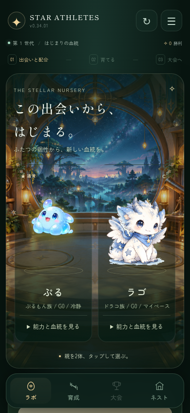
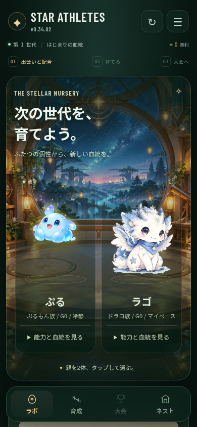
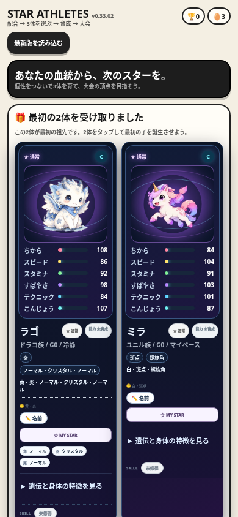
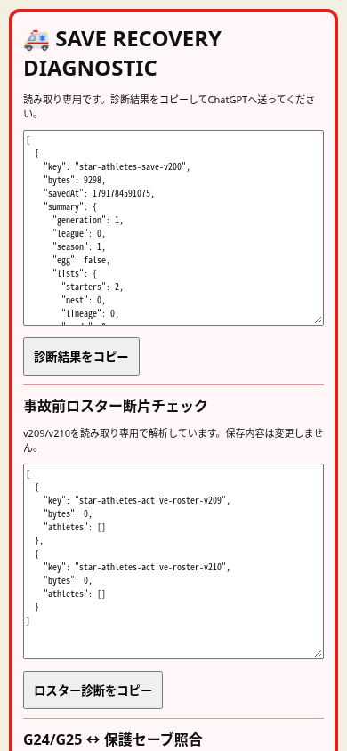

# インディーゲーム比較・現状評価と販売品質への改善

評価日：2026-10-12。対象ソース：`tk-lab2222/-game-preview` main `0661ad4fe1b6c9809f12393a44032b375dc3809b`。今回の改善版：STAR ATHLETES v0.34.03（不具合修正版v0.33.02からUIを再構成）。

最新の変更：[命名・キャラ素材とラボの文字削減 v0.34.03](STAR_ATHLETES_NAMES_AND_ART_2026-10-12.md)。4種族の基本絵を高解像度の透明素材へ変更し、自動命名を統合。ラボと誕生は文字を減らす案を既存の処理に実装した。全画面の文字削減、表情・ポーズ・遺伝形状の描き分けは未完了。

**現時点では有料インディーの比較基準に到達したとは判定しない。** STAR ATHLETESには配合・育成・大会の核があるが、起動不良、過剰な診断表示、情報の密度が試遊を妨げていた。今回は起動エラー4件を解消し、既存のキャラクター描画を復旧、情報を整理し、最初の大会と保存復旧まで確認した。長期プレイ、実機操作、再挑戦したくなる理由、販売反応は次の検証対象である。

この文書の画像はローカルの実装をChromiumのスマホ設定で動かした実画面。以前提示した生成コンセプト画像とは別である。公開URLへの反映、実機Safariでの動作、競合作品の実プレイは今回の確認に含めていない。

納品状態：2026-10-12にユーザーが改善コード・評価レポート・実画面を公開GitHubの変更提案に載せることを明示的に承認した。実画面と検証結果を含む変更提案を作成する。公開ゲームへの配備は別の状態であり、この文書だけでは反映済みと扱わない。

## 比較作品と取り入れる品質

公式ストアの説明・画面・購入者レビューを参照した。ジャンルと制作規模が違うため、同じ価格や機能数をそのまま目標にしない。

| 対象 | 参考作品 | 取り入れる品質 | 自作ゲームへの判断 |
| --- | --- | --- | --- |
| STAR ATHLETES | [Monster Sanctuary](https://store.steampowered.com/app/814370/Monster_Sanctuary/) | 3体の組み合わせ、育成の選択、キャラクターごとの役割 | 親と子の違いが次の大会の戦略に結びつくことを優先。説明やスキルを増やすだけでは不足 |
| STAR ATHLETES | [Monster Crown](https://store.steampowered.com/app/830370/Monster_Crown/) | 配合で新しい個性を作る楽しさ | 誕生前の期待と誕生後の発見を強める。細かな操作の多さ、進行停止、保存事故を避ける |
| STAR CLIMB | [Downwell](https://store.steampowered.com/app/360740/Downwell/) | 小さな画面での視認性、短い挑戦、上達を感じる操作 | 上昇・下降の違いは維持し、失敗理由と再挑戦の速さを比較基準にする |
| 星火ピンボール | [DEMON’S TILT](https://store.steampowered.com/app/422510/DEMONS_TILT/) | 盤面のテーマ、打球の反応、狙いと得点のつながり | 発光を増やす前に、球・主目標・成功の反応が区別できるかを確認 |
| MINE & GROW案 | [Tametsi](https://store.steampowered.com/app/709920/Tametsi/) | 読みやすい盤面、丁寧な問題、推理への信頼 | 問題の質と操作ミスへの配慮が中心。今回ソース未確認なので既存ゲームの点数は付けない |
| MINE & GROW案 | [DemonCrawl](https://store.steampowered.com/app/1141220/DemonCrawl/) | 推理に成長と報酬を組み合わせる設計 | 成長要素が推理の納得感を壊さないこと。アイテム数を品質の代わりにしない |

DownwellとTametsiは小規模な有料作品の比較軸、Monster SanctuaryとDEMON’S TILTは仕上げと深さの参考にする。らくがきダッシュはこの6作品との直接比較より、「描いた形が走り方になる」という独自性の試遊検証を優先する。

## レビューから分かった離脱の原因

各作品の最近のSteam購入者レビューを20件ずつ、計120件取得した。取得条件は `language=english&purchase_type=steam&filter=recent&num_per_page=20`。肯定・否定のサンプルを精読し、操作、保存、再挑戦、情報量に関する指摘を抽出した。英語指定でも他言語の文が混ざることがある。最近の小さな標本であり、全購入者の満足度、売上、スマホ市場の傾向を推定するものではない。

| 作品 | 取得数 | 肯定 / 否定 | 読んだサンプルからの示唆 |
| --- | ---: | ---: | --- |
| Monster Sanctuary | 20 | 17 / 3 | 選択の深さは魅力。複雑さと反復の負担を入口で増やしすぎない |
| Monster Crown | 20 | 7 / 13 | 絵や収集への期待だけでは、遅い導入・操作の多さ・不具合への不満を補えない |
| Downwell | 20 | 17 / 3 | 習得しやすさと上達の余地が再挑戦を支える。一方、繰り返す失敗に意味を感じない人もいる |
| DEMON’S TILT | 20 | 17 / 3 | 連鎖と操作の熟練が魅力。入力反応・盤面の理解・刺激の強さは好みと使いやすさを左右する |
| Tametsi | 20 | 18 / 2 | 丁寧な推理問題が価値。誤操作や疲労が楽しさを妨げる場合がある |
| DemonCrawl | 20 | 14 / 6 | 成長は魅力にも負担にもなる。クラッシュの報告や推理と運の相性への不満がある |

個々の不具合報告は競合作品で再現した事実ではない。取得時の件数とAPI条件は [review-sample-summary.json](quality-2026-10-12/review-sample-summary.json) に保存した。

自作ゲームへの最優先の示唆は、**起動と保存を確実にし、最初の選択を分かりやすくし、次の挑戦に理由を作ること**。グラフィックは魅力の入口だが、操作の負担や進行停止を埋め合わせられない。

## 現在の仕上がりの評価

| ゲーム | 実際に確認した範囲 | 強み | 販売前に残る課題 | 判定 |
| --- | --- | --- | --- | --- |
| STAR ATHLETES | 起動、配合3回、孵化、3体採用、育成、最初の大会、リロード、保護セーブ復元、壊れた主セーブからの復旧 | 血統をつなぐ選択、個性のある既存キャラクター、育成と大会の接続 | 初見の迷い、長期バランス、継続動機、音と演出の一体感、実機確認 | 改善した試遊版。販売品質の判定は保留 |
| らくがきダッシュ v2.2 | 起動画面・ソース確認。初期エラー0件 | 描いた形を能力と動きに変える、一目で伝えやすい題材 | 初見の描画→レース→再描画の完走、形の違いが結果に与える納得感、実機入力 | 小規模な市場テストの候補。まだ完走確認前 |
| 星火ピンボール v0.9.2 | 起動画面・ソース確認。初期エラー0件 | 60秒の挑戦、ボスと目標、画面に収まる盤面 | 小さい操作ボタン、球と目標の読みやすさ、入力遅延、得点の理由、60秒の完走 | 試作として成立。操作品質の確認が必要 |
| STAR CLIMB | 既存SitesプロジェクトとURL、保存版104を確認 | 既存プロジェクトを引き継げる | この環境ではソース取得とゲーム実行が未完了。保存版と公開版の同一性も未確認 | 未評価。古いv0.9記録で現在の品質を判定しない |
| MINE & GROW | 以前の企画イメージのみ | 推理と成長を組み合わせる候補 | 実装場所、盤面生成、推理の公平性、保存、実機プレイの確認 | 未評価。生成画像を完成実装に数えない |

STAR ATHLETESを育成ゲームの主力候補として続ける。らくがきダッシュは低い追加コストで独自性を試す候補。これは現状からの開発仮説であり、どちらが売れるかを実証した結論ではない。

## 競合作品の文字組みを比較し、書体を変更 v0.34.02

v0.34.01の明朝＋丸ゴシックはユーザーから「安いゲームの文字」と評価された。今回は『Cassette Beasts』『Hades』『Cult of the Lamb』の実画面を比較し、タイトル・人物名・本文・数値の役割を分ける設計へ変更した。比較した画像、観察と採用理由は[文字組みの分析・決定記録](STAR_ATHLETES_TYPOGRAPHY_2026-10-12.md)に記載。競合の正確なフォント名は未確認であり、ゲームからフォントや画像を抽出・流用していない。

日本語をNoto Sans JP由来の角ゴシック400/600/700へ、英字ロゴと一部数値をBarlow Condensed SemiBold由来の縦長書体へ変更。見出しとキャラ名は実際の700ウェイト、説明は400、操作は600とし、擬似的な太字を使用しない。旧3フォント・ライセンス・読み込み指定は削除した。新4ファイルは合計約0.53MB。SIL OFL1.1の著作権・ライセンス、出典・ハッシュ・再構築方法を同梱。収録範囲外の人名文字は端末の書体へフォールバックする。

以下は同じ保存データ・同じ2体の実画面。全4書体の読み込みと見出し・名前の太さ、幅320/390/414px、配合から最初の大会と保存復旧まで確認した。好み、没入感、売上への効果は未検証。

| 修正前 v0.34.01 | 書体変更後 v0.34.02 |
| --- | --- |
|  |  |

## 没入感を作るUIへの再構成

ユーザーから「もっと根本的にUIを変えてほしい。没入感がない」との指示を受け、v0.34.00では画面の主役と情報の順序を変えた。

- 初期画面を星空の研究所の情景と、大きな2体のキャラクターで構成。背景用のオリジナルアートを生成し、実際のゲームの画像素材として組み込んだ。キャラクターは既存素材と既存の描画を使う。
- 常時表示していた能力値・血統・細かな操作を開閉式の情報へ移動し、キャラクターを選ぶ体験を先にする。
- 配合の準備、タマゴを開く、誕生の表示を段階ごとに切り替える。既存の孵化処理と保存を維持し、誕生したキャラクターへ画面を移動する。
- 下部の主な移動先はラボ・育成・大会・ネストの4つ。ミッション・図鑑・代表戦・MY STARは研究ノートから開く。各画面と育成中の配合制限は維持する。
- 旧い6列・横スクロールのナビゲーション定義を担当箇所から除去した。研究ノートの開閉は既存の共有プレビュー層のネイティブdialog機能を使う。
- テーマを深い緑、星明かり、暖かな金色に揃える。動きを減らす端末設定ではアニメーションを止める。

| 前回の修正版 v0.33.02 | 新UI・現行提案 v0.34.02 |
| --- | --- |
|  |  |

画面構成の改善は実装したが、第三者が没入感を感じたことや売上への効果は未検証。背景PNGは元の生成画像をそのまま収録しており、公開配備時の通信量と表示時間は追加評価が必要。

## 不具合修正と実画面

| 改善前 | 改善後 v0.34.00 |
| --- | --- |
|  |  |

実際の [誕生画面](quality-2026-10-12/athletes-birth-after.png) と [最初の大会結果](quality-2026-10-12/athletes-tournament-after.png)。比較対象の現状画面：[らくがきダッシュ](quality-2026-10-12/doodle-viewport-before.png)、[星火ピンボール](quality-2026-10-12/pinball-viewport-before.png)。

- 起動時のJavaScriptエラー4件を解消。壊れていた既存のキャラクター描画を復旧し、名前と能力値を読みやすくした。キャンバスを複製して一部キャラが空白になる問題も、元の描画要素を保持する形で修正した。
- 通常起動で復旧診断を前面に出さず、必要なときは `?diagnostics=1` で利用できる。復旧機能は維持する。
- 親の詳しい遺伝・身体情報を開閉式にし、2体選択したら既存の配合操作へ移動する。情報を見る操作は親の選択にならない。
- 育成疲労の更新を既存の育成本体に統合。重複フックを実行対象から外し、成功した育成で1回だけ更新する。
- 保護セーブとバックアップの復元で状態オブジェクトを置き換えず、既存の参照を保って全状態を復元する。
- 既存の共通エラー表示を使い、復旧の案内をプレイヤー向けの文にした。
- 試遊一覧にSTAR ATHLETESとらくがきダッシュを追加し、STAR CLIMBの既存URLへ接続した。各ゲームの公開反映はこの変更の配備後になる。

**担当箇所の整理：** GAME COREは既存の配合321・育成263・保存200/326/352・描画369・孵化127・誕生201・ナビゲーション285/323/230・既存リリーススキンstyle-v094.css。SHARED ASSETは既存 `_shared/game-preview-standard.js` のエラー表示とdialog開閉。RETIREは壊れた重複疲労フック265の読み込み、および201/203/285の競合する旧ナビゲーションの外観定義。件数欄に説明文が入って画面幅を広げていたアーカイブの誤った参照も修正した。まとめ配合は開閉式の任意操作として残した。新しい上書きパッチは追加していない。全状態保存と希少スキルの誕生処理を維持し、古い検査の文字列期待を現在の責務に合わせた。

## 「120%」の達成条件

市場全体の順位を数値で測れないため、開発上は「比較作品に学ぶ基本品質100点分＋自作ならではの強み20点分」と定義する。配点は内部の優先順位であり、販売実績や達成率の測定値ではない。未確認項目には点を付けない。

| 基本品質の目標 | 配点 | 合格条件 | 今回の状態 |
| --- | ---: | --- | --- |
| 安定性と保存 | 20 | 正常起動、長期進行、再開、復旧で成長を失わない | 短い一連の流れと復旧は確認。全シーズン・世代交代は未確認 |
| 最初の30秒 | 20 | 初見の人が説明を受けずに最初の意味ある操作をできる | 導線を改善。初見の人での確認は未実施 |
| 操作と読みやすさ | 15 | スマホで押し間違えにくく、球・キャラ・目標・文字が読める | STAR ATHLETESの幅320/390/414pxを検査。実機の指操作は未確認 |
| 核の面白さ | 15 | 選択の違いが結果に表れ、失敗理由と次の工夫が分かる | 配合から大会への動作は確認。面白さ・バランスは未検証 |
| グラフィックと音 | 10 | 絵、UI、動き、音の方向性が揃い、成功が気持ちよく伝わる | 既存描画を復旧。音と演出の評価は未実施 |
| 続ける理由 | 10 | 次の目標が分かり、再挑戦が負担にならない | 長期プレイと再訪は未検証 |
| 販売時の約束 | 10 | 実画面と説明が遊べる内容に一致し、価格に見合う内容がある | 実画面を取得。価格・販売ページ・購入反応は未検証 |
| 独自の強み | +20 | 例：自分の血統のスター誕生、描いた形が走り方になる体験を人に見せたくなる | 候補はある。第三者の反応は未検証 |

致命的な進行停止・保存消失が残る場合は合計点に関係なく販売を止める。画面の美しさだけで合格にしない。

## 次の実装と検証の順序

1. **STAR ATHLETESの長期進行と初見の迷いを解消。** S1→S6、大会の勝敗、昇格、次世代、途中再開を確認する。初回だけの短い案内と、次の操作が1つ見える状態を整える。既存のセーブを使った検証を先に行い、機能追加は必要な箇所に絞る。
2. **小さい画面と入力の仕上げ。** 実機Safariを含め、押せる領域、配合カードの情報密度、スクロール量を確認する。ピンボールは球・的・フリッパーを優先し、らくがきダッシュは描画→結果→再描画を完走する。
3. **1つの強みを演出で伝える。** STAR ATHLETESは親の特徴が子へつながった瞬間、らくがきダッシュは形が走り方へ変わる瞬間を磨く。派手な全画面エフェクトやアイテムを先に増やさない。
4. **初見の人5名で試遊。** 最初の操作までの時間、迷った箇所、完走、再挑戦、自分の言葉で説明できた魅力を記録する。本人の理解を誘導しない。ここでの確認が済むまで「誰でも分かる」と書かない。
5. **小さく販売仮説を試す。** 既存ブラウザ版＋itch.ioを低コストな候補として扱う。実画面、短いプレイ動画、内容に合った価格案を用意し、試遊後の購入意思と実際の反応で決める。Steamレビューから自作の売上を算出しない。

現行のHTML/JavaScriptと既存素材を使った今回の改善に、有料の新規素材や商用エンジンは追加していない。App Store等への展開費用は別途決める。サイトの実行環境や外部サービスが永久に無料とは扱わない。

## 再現と残る確認

通常の検査：

```sh
python scripts/check_star_athletes_release.py
python scripts/check_star_athletes_save_contract.py
python scripts/check_star_athletes_upper_rarity_contract.py
git diff --check
```

ブラウザ検査（Python PlaywrightとChromiumが必要）：

```sh
python -m pip install playwright
python -m playwright install chromium
python scripts/verify_star_athletes_browser.py --output /tmp/star-athletes-qa
```

ブラウザ検査はリポジトリのファイルを隔離した `games.local` にルーティングし、外部通信とService Workerを止める。実際のUI操作で配合・孵化・採用・大会へ進む。疲労と保存の例外条件は隔離状態へ入力する。実ユーザーのセーブや公開サイトを変更しない。

今回の結果：上記3つのガードは合格。ブラウザで初期エラー0、読み込み失敗0、4つの主ナビゲーションと研究ノートの4画面への遷移・閉じる動作、候補の詳細開閉で選択が変わらないこと、候補・アーカイブ表示後も幅390pxを保つこと、育成疲労の単一更新、再読み込み時の個体IDと未知の入れ子データの保持、保護復元と壊れた主セーブの復旧を確認。実行証跡は [verified-flow.json](quality-2026-10-12/verified-flow.json)。

未確認：実機iPhone/Safari、公開配備後の動作、全シーズンと世代交代、低性能端末のフレーム速度、長時間のメモリ使用、アクセシビリティ全般、継続率、売上。STAR CLIMBはソース取得から再開する。Alpha Lab全体のWindows/Tailscale/iPhone受入確認も別途未完了で、今回のゲーム検証で完了扱いにはしない。
