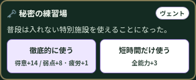
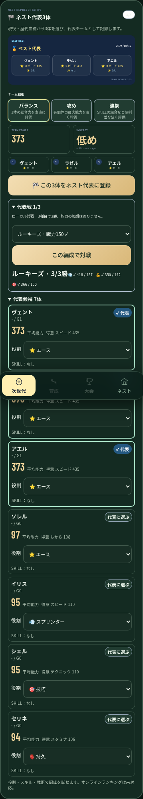
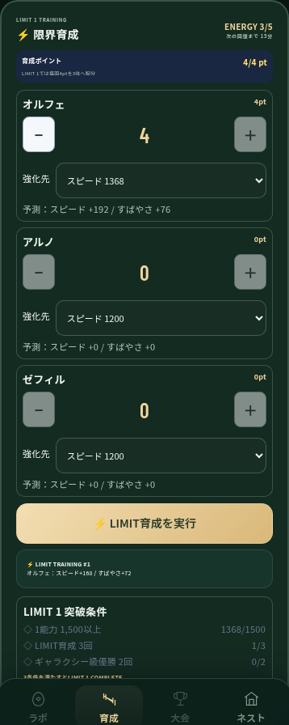

# STAR ATHLETES — 育成・血統・代表戦の見直し

対象は提案版 v0.34.04。ユーザーが、メモに残した案を今回の改善へ組み込み、ゲームバランスも見直すよう依頼した。主要な仕組みは既存コードにあり、今回は判定・進行・報酬・対戦への接続を修正した。新しい runtime patch / loader は追加していない。公開サイトへの配備、売上・継続率、実機Safariの完成は主張しない。

## 今回の内容

| 要素 | 調査した問題 | 最終の変更 |
| --- | --- | --- |
| 神速・巨神・異形・純血・混血 | 純血が単なる世代番号で成立。確率表示と複数レシピの優先抽選が一致しない | 同種族の連続した祖先枝を個体へ記録。異種交配で純血の連続回数をリセット。旧個体の世代番号から祖先を捏造しない。1回の区間抽選で、成立した各レシピの表示確率と獲得率を一致させる |
| 配合研究 | 純血の手がかりも世代番号で進み、親の組合せとの関係が薄い | 血統の連続回数と同じ判定を使用。選択した親のスキル・素質・血統に反応する系統数を表示。予測は親や子を変更しない。既に得た研究記録は保持 |
| 育成イベント | 最大3回、通常練習に対して大きな報酬。遅延クリック監視で発生し、最後のラウンドや無効入力の扱いに問題 | 有効な練習の確定時だけ処理。世代で最大2回、成功回数を重複計数しない。報酬を縮小し、選択前に成功率・能力変化・疲労・失敗結果を表示。未選択のイベントは保存し、育成・大会へ進む前に解決 |
| ストーリー育成 | 表示ケガ率が独自の式で実際の判定と不一致。方針の古いwrapperと疲労の遅延処理が残る | 263のケガ率を275が直接使用。方針と疲労は263で一度だけ計算。通常育成は999まで、保存済みの999超を下げない |
| 世代をつなぐ成長 | 通常の血統でも進めるが、近似モデルで中盤の反復が長い | 獲得成長の継承率を48〜60%へ。リーグ別の通常育成倍率は1 / 1.3 / 1.6 / 1.9 / 2.2 / 2.5。新しい子の継承率を記録。既存個体の能力を書き換えない |
| 宿敵血統 | UIに出る得意・弱点が実際の固定対戦相手に反映されず、結果文から撃破を推定 | 225の相手生成時に268の血統・名前・得意・弱点を設定。勝率も225の相手生成を使う。実際の大会結果から撃破を記録。格下は撃破記録の対象外、標準・格上の総合1位で登録。既存の撃破記録は保持 |
| 血統ミッション | 永久の全能力加算が無制限。歴代個体だけで現在の世代目標が成立 | 世代目標は現役3体で判定。新規報酬は60コイン、長期目標150コイン。能力加算は累計+30まで。旧個体の獲得済み能力・達成記録は保持。旧SSR目標は現行の出生グレードに合わせた「輝星以上」へ |
| LIMIT1 | 加算が育成の継承記録へ残らない。配分を0へ戻すと勝手に初期化。消費時に回復時計の途中経過を失う | 実際の能力差分を226へ記録。配分を保持し、0の編集を尊重。配分した個体だけを育成。回復時計を保持し、対象能力が全て上限なら消費しない。獲得済みのLIMIT突破は保持 |
| ネスト代表 | 固定値の連携加算が高能力になるほど無意味。平均的な編成でも攻めが6%加点 | 役割・能力の偏り・スキル・連携を能力規模に応じて評価。レア度を直接加点しない。旧評価のベストは新評価を登録する際に保存し、評価方式をまたいで比較しない |
| 代表戦 | 自己ベストの登録だけで編成を試す対戦がない | 既存280にローカル3種目対戦を接続。2勝で勝利、相手はルーキーズ・グランド・星海・LIMIT解禁後の限界選抜。同じ編成・能力・相手では結果を引き直さない。能力・通貨の周回報酬はない。現役ロスターは変更しない。結果は直後に開いて表示 |
| 画面 | 明るい旧パネルに新UIの白い文字が乗る | 既存release skinにイベント・代表・LIMITの色と文字サイズを統合。選択と結果が読める状態に調整 |

通常大会には世代・シーズン・リーグ単位の完了確認を追加し、再実行で報酬を受け取れないようにした。年間結果の参照も、記録済みの世代番号を確認する。共有の既存導線は保持し、自動投稿や決済は追加していない。

## 数値評価

[実行する解析スクリプト](../scripts/analyze_star_athletes_balance.cjs)は現在の実装ファイルをVMへ読み込み、実際の育成・出生・血統・代表評価関数を使う。

- 20,000回ずつの結果判定では、平均的な素質・好調時のケガ率は安全0%、標準約2.7%、高負荷約18.8%。疲労時の高負荷は約46.4%。表示の式と実測を照合した。
- 疲労がない時は高負荷に上振れの価値があり、疲労が蓄積すると安全・標準へ切り替える理由がある。全ての素質・模様・方針・競技編成に最適性を保証するものではない。
- 500世代のイベント測定は平均1.466回。どの世代も最大2回以内だった。
- 条件を整えた50,000回のレシピ抽選で、各系統の観測頻度と表示確率を照合した。研究・レシピのプレビューでは乱数を引いたり血統回数を書き換えたりしない。
- 代表の検証編成ではレア度だけの変更で評価は増えず、役割・スキルの組合せで評価が変わった。
- 40シードの保守的な近似進行モデルでは全てが45世代以内にギャラクシーへ到達し、中央値19世代、範囲17〜21世代だった。

進行モデルは4種目固定・3体の専門育成・親2体の選抜を使い、ミッション報酬、実戦成長、見た目の上位特性による直接能力加算を含めない。昇格戦は4種目中3種目で有利かを使う近似で、実際の年間対戦・ユーザー判断を完全再現しない。**19世代は実プレイヤーの攻略日数・プレイ時間ではない。** 実プレイヤーでのテンポ、初見理解、選別の楽しさ、LIMITの待ち時間を評価する必要がある。

[数値結果](quality-2026-10-12/balance-numerical.json)

## 実際の操作と保存の検証

[ブラウザ検証](../scripts/verify_star_athletes_balance.py)は隔離mobile Chromiumで実行し、次を確認する。

- 配合・孵化・採用、イベント発生→無効/重複入力→リロード→選択→能力差分と継承記録。
- 旧個体の大きい世代番号では純血が成立しない。同種族の出生をつなぐと2→3→4→5、異種交配でリセット。予測は個体を変更しない。
- ミッションの能力上限と繰り返し描画の無加算。
- 検証用の能力350の編成でS1〜S6の実際の練習・大会→年間王者→昇格戦→次世代→配合・孵化・採用。大会の再実行でコインを再取得しない。
- 代表選択→旧ベスト保持→新評価登録→ローカル対戦→同じ結果の再表示→リロード。現役の個体は変更されない。
- 検証用の年間王者・能力999の編成から、実際の惑星代表戦→LIMIT解禁。その後、選択配分→実際の育成差分・継承記録・回復時計・全能力上限での無消費・保存済み3500の保持。
- 幅320/390/414、実行エラー・素材欠落なし。

能力と進行のfixtureを使う検証は経路の正しさを確認するもので、新規プレイヤーが全編をクリアした証拠ではない。既存のブラウザスモーク検証で、未知の保存フィールド・名前・保護保存・破損primaryからの復旧・全4種族の実描画も確認する。release/save/upper-rarityの3ガードを実行する。

[操作結果](quality-2026-10-12/balance-flow.json) · [スモーク結果](quality-2026-10-12/balance-smoke.json)

| 育成イベント | 代表戦 | LIMIT育成 |
| --- | --- | --- |
|  |  |  |

## 実装範囲と担当

GAME CORE: 225/233の大会・年間進行、226の成長記録・継承、263の通常育成、267のイベント、268の宿敵定義、269のミッション、273の特殊血統、276の研究、278/279のLIMIT、280の代表・ローカル対戦。SHARED ASSET: 既存GamePreviewStandardのエラー表示・更新・native dialogを利用。RETIRE: 266の到達不能な結果wrapperと遅延疲労補正、275の別ケガ率式、268の結果文監視と未使用相手能力式、302の重複血統一覧、295の別リーグ能力テーブル、267の遅延クリック発生と不要カットインCSS。

Added: ローカル代表戦、血統連続回数、反復可能な数値/操作検証。Modified: 上表の既存担当処理とrelease skin。Deleted/superseded: 上記の重複・未使用・不一致経路。既存データを上書きして新しい開始状態へ置き換えていない。

外見の幼体→成体、当初の追加種族一覧の回復、段階別素材・アニメーション、オンライン代表戦、実機iPhone・低性能端末、価格・販売・継続率は別の未完了項目。出生の希少度と能力ランク、個体の外見成長と世代番号は引き続き区別する。
