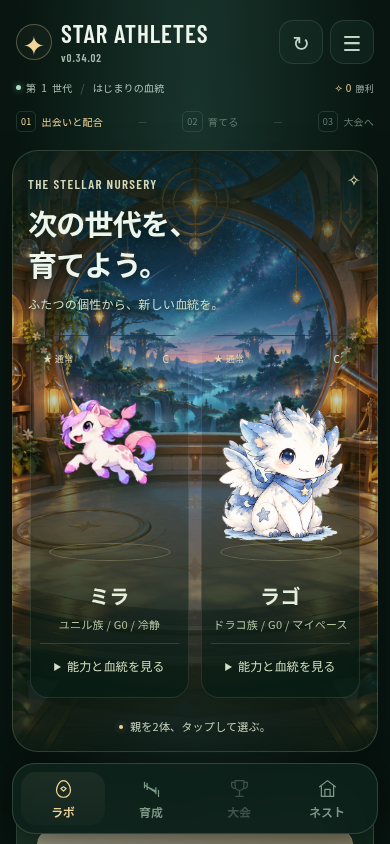
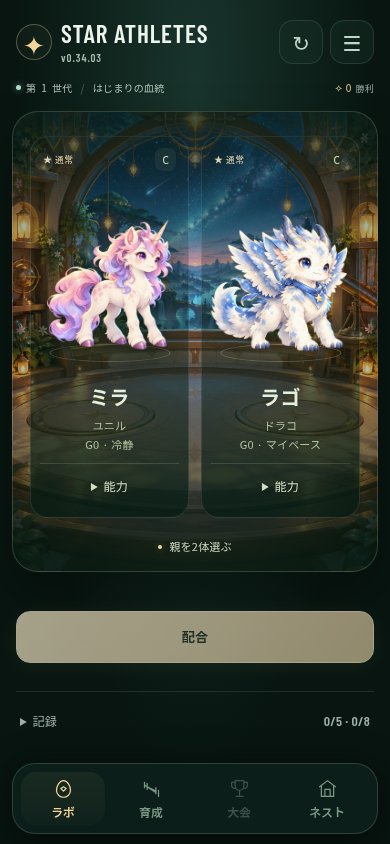

# STAR ATHLETES — names and character art, v0.34.03

The human requested better naming rules and further character-graphics work, after approving the low-text direction. This revision integrates new art and naming in the actual runtime, and implements the first low-text lab/birth step in the existing owners.

## Names

Species display names consistently use short katakana without the humanoid-sounding 「族」 suffix. Internal species IDs remain unchanged:

| ID | Previous display | Current display | Example new individual names |
| --- | --- | --- | --- |
| draco | ドラコ族 | ドラコ | アストラ / ノクス / リュカ |
| unil | ユニル族 | ユニル | ルミナ / セレナ / ティリア |
| grimo | グリモ族 | グリフォン | フェルン / アルク / ゼフィル |
| puru | ぷるもん族 | ネリス | ミレア / アクア / リュミア |

Ordinary defaults are 3–5 katakana characters. Species have a consistent vocabulary/phonetic family rather than a mixture of food names, hiragana baby-talk, shortened species plus random digits and numeric duplicate suffixes. Each species first uses 16 curated names, then combinations of its stems/endings when names are taken. Extremely large archives use a pronounceable kana disambiguator after a middle dot, rather than an ID/number. Avoiding duplicates considers all recorded character pools, the current egg and names issued in the current session, so simultaneous batch births cannot choose the same name before joining the candidate array. This is not a guarantee of trademark uniqueness or globally unique player names.

`app-v094.js` owns generation for founders, birth, scouts and missing-name repair. The duplicate baby-name wrapper in224 and the fixed scout name table in117 are removed. Founder selection is moved into the core initialization and runs only when founders are absent; the redundant105 loader is retired. Existing valid names, including custom names, are preserved. A player's manual rename remains available, normalized to NFC and limited to 12 Unicode code points. It is not forced to follow the automatic naming vocabulary. The training owner now reconnects the rename UI after rebuilding the roster; it uses the stable athlete ID and the content container rather than a transient option or avatar node.

The optional preference question was not answered before this revision, so the default direction is short, fantasy-like and less childish. The user can still steer the naming vocabulary; this does not retroactively rename saved characters.

## Art

The previous Unil/Grimo/Puru source images were only 112×112px. The previous normal Draco PNG was 416×470px and contained surrounding paper/printed artwork. Four original refinements were generated with `image_gen` from those existing creature references and a common visual direction. Each new sprite is a transparent RGBA PNG at 1254×1254px, copied byte-for-byte from the generation output. Source identifiers, hashes and sizes are in [the manifest](../star-athletes/assets/creatures/manifest.json).

The new assets emphasize coherent silhouettes, expressive faces, grouped feathers/fur/mane and a consistent warm/cool light treatment. The water creature has visible refraction highlights and an internal luminous core. Actual species canvases load the new assets directly instead of fetching and concatenating nine base64 fragments. Canvas CSS dimensions remain independent of backing-pixel dimensions; DPR-aware drawing and high-quality downsampling stay in the existing species renderer. Fitting and vertical anchoring are adjusted in the existing renderer/portrait owners to reduce apparent size and grounding differences. Draco's existing stable renderer consumes the new transparent sprite. Existing color/shiny/rarity presentation and genetic data remain connected.

These are four base sprites, not skeletal animation or an atlas of genetic horn/wing/tail variants. In particular, Draco's previous stable path already displayed one base sprite while showing inherited parts in data/details; this revision does not claim those parts now alter the sprite. Expressions/poses, visible genetic variants and physical-device performance remain further work. The four unmodified PNGs total 6,710,594 bytes; mobile transfer and memory cost remain material and have not been validated on an actual device.

## Low-text step now implemented

The previous DOM-only proposal is now implemented for the main lab and birth flow: remove the decorative English/story headings and duplicate journey text from the shell; retain one short phase-dependent hint and 「配合」 action; use 「能力」 for native detail entry; show research/archive through 「記録」. Research, archive, selection and their counters remain accessible after rerender and reload. The existing relocation owners285/321 place the panels in the canonical record container rather than restoring the old verbose layout. Birth keeps the character/name/status/detail and a short 「誕生」 label.

The original temporary-prototype count (258→50 non-status characters over a complete initial page) remains historical evidence of feasibility. Do not apply that exact percentage to this revision or to training, tournament and Nest, which have not undergone the complete text-density redesign.

## Actual evidence

| Same isolated save, v0.34.02 | v0.34.03 |
| --- | --- |
|  |  |

[Four-species gallery](quality-2026-10-12/four-species-after.png) uses a separate isolated browser fixture with all four species and a two-column gallery layout for inspection. A normal fresh game still starts with two founders. [Birth](quality-2026-10-12/character-birth-after.png) and [verification results](quality-2026-10-12/character-flow.json) are actual browser output, not generated UI concepts.

Verification: three release/save/rare-inheritance guards; portable mobile Chromium flow through three pairings/hatches, candidate selection/adoption, real manual rename, training/reload, first tournament, protected restore and corrupt-primary recovery; same-save founder names/IDs preserved; 192 generated-name samples unique without numeric suffixes; all four high-resolution assets decoded and all live sprite canvases contained nonzero pixels; record/native ability disclosures and all journal routes; widths320/390/414px. Runtime errors and missing assets must be zero before publishing the proposal.

Ownership: GAME CORE = core naming/init, rename224 consumed by training210, sprite renderer116/stable329/330, existing skin/character369, lab321, birth201, research276 and navigation285. SHARED ASSET = continue consuming existing preview/dialog behavior. RETIRE =105 loader,224 name wrapper,117 fixed scout names, active base64-fragment sprite loader and redundant lab narrative. No new runtime patch or observer was added. The proposal is a draft PR; public deployment and physical Safari/device acceptance are separate from these checks.
