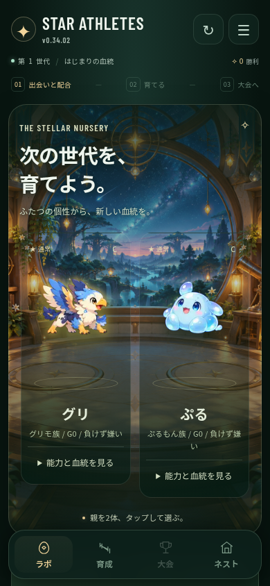
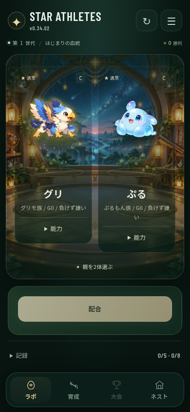

# STAR ATHLETES — reduce non-status text to about one fifth

Human direction: preserve status information and consider reducing other text to roughly 1/5. This document evaluates the proposal and provides an isolated visual prototype. It does not claim the complete game has been redesigned or deployed.

## Findings

The source under review is `224a0f7b344ca8d32b6baf573ecd72c6600e8c84` (v0.34.02). Real mobile Chromium inspection covered initial parent selection, two parents selected, egg, first birth, training, tournament setup/result and Nest. Training contains about 1,900 visible characters over the full scrollable page, including status values; league ladder, annual ranking, three tournament choices, policy, three individual training panels and four event assignment panels occupy one screen. Nest mixes shopping with design-policy explanation, unreleased monetization concepts and save diagnostics. Reducing copy should therefore include separating responsibilities and removing development-oriented copy from ordinary play.

The exploratory multi-screen audit excludes closed disclosure contents and hidden elements. Its totals include status values and exclude the bottom navigation outside `.a`; they are evidence of density, not a claimed 80% reduction. The separate before/after prototype measurement below includes the navigation, retains the same isolated save and excludes status fields explicitly.

## Same-save lab prototype

| Measurement | Current | Proposed |
| --- | ---: | ---: |
| Non-status characters, whole rendered page including scroll below viewport | 258 | 50 |
| Non-status characters intersecting initial viewport | 149 | 50 |
| All displayed characters including status information | 330 | 108 |

The whole-page non-status ratio is 19.4%, close to 1/5. The initial viewport ratio is 33.6%, approximately 1/3. Do not claim every viewport or game screen already reaches 1/5. This is a visibility reduction: details remain available on demand, not all text removed from the game.

Counting removes whitespace and counts Unicode code points, including Japanese text, Latin, punctuation and text-based symbols. Hidden elements, closed disclosure contents, script/style/option nodes are excluded. Status classification includes generation/wins metadata, species/generation/personality, rarity/grade, stat rows, research progress and archive counters. Character names, wordmark, action/navigation labels and their symbols remain in the non-status count. Complete counted text and the exact status flag per node are in [lab-text-comparison.json](quality-2026-10-12/lab-text-comparison.json).

| Current v0.34.02 | Isolated visual proposal |
| --- | --- |
|  |  |

The prototype removes the decorative English eyebrow, story heading, subtitle and duplicate journey explanation. It replaces multiple instructions with 「親を2体選ぶ」, shortens the action to 「配合」 and detail entry to 「能力」, and groups research/archive in a 「記録」 disclosure. Existing font, art, state and status content remain. The starter data was unchanged, native ability and record disclosures remained accessible, and no runtime errors or missing assets occurred during this isolated inspection.

These screenshots use temporary DOM modifications in an isolated browser. They are not generated concept art, and they are not a production implementation. Existing runtime renderers can restore original copy or placement after interaction; the inspection reapplies the visual proposal after disclosure checks. Do not infer complete gameplay compatibility from this prototype. Stable production behavior requires changing the canonical owners described below and testing actual play.

## Proposed screen responsibilities

| Screen | Ordinary view | On-demand detail or different destination |
| --- | --- | --- |
| Lab | Two parents, identity/status, selection highlight, one hint, one phase action | Research, archive, inheritance explanation; show compatibility numbers after selecting parents |
| Birth | New character, name, rarity/status, selection action | Parent lineage and inheritance breakdown; remove repeated “NEW ATHLETE” and story sentence |
| Training | Character/status, short menu labels, load and injury risk, predicted gain, execute | League/ranking overview, training-policy explanation; tournament selection and assignment belong to tournament preparation |
| Tournament | Opponent, selected entrants/strategy, chance/reward, start; then ranks and gains | Broadcast-like decorative headings, detailed race logs and repeated explanations |
| Nest | Roster/identity, useful shopping actions, prices and effects | Collection history, save protection, advanced lineage enhancement; remove development-policy and unreleased pricing concepts from normal play |

Status values, costs, chances, injury risk, selected load, stat gains, destructive confirmations and error messages must remain intelligible. Keep short labels on unfamiliar actions. Icons, highlights and animation can communicate selection or success; a mystery icon without a recognizable meaning is not an adequate replacement for a decision or warning.

## Concrete copy targets

| Current | Proposed |
| --- | --- |
| この2体から、スターを誕生させる | 配合 |
| 能力と血統を見る | 能力 |
| この内容で練習する | 練習 |
| この3体をネストへ | 採用 |
| 3体それぞれの育成種目と強度を決めます | Show selected menus and loads on the three character panels; omit repeated prose |
| ケガなし / 成長小; 高リスク / 上振れ大 | Preserve actual injury % and predicted stat gains beside the load selection |
| 次の大会：［大会名］（標準） repeated below selected card | Show selected state on that card once |

The target is approximately 20% of baseline default-visible non-status characters per comparable state, measured from the same save, with a separate initial-viewport measure. Name length and unlocked content vary, so report actual counts rather than inventing one universal percentage. Help/detail text is measured separately. Learnability needs player testing; functional checks alone do not establish it.

## Ownership and next implementation

GAME CORE: replace copy/layout in existing release skin and shell, breeding321, birth201, training210/263, tournament290/225, candidate262, research276/286, Nest201/shop309 and advanced facilities352. SHARED ASSET: consume existing dialog/navigation/preview behavior. RETIRE: redundant headings/descriptions, repeated status renderings after mapping their consumers, and development-policy copy in ordinary play. Do not add another runtime patch or merely hide everything through a new overlay.

Recommended implementation order: phase-based lab/birth, focused training and tournament preparation, then Nest. Preserve per-individual training choices, breeding caps/batching, inheritance, rarity-versus-strength separation and save behavior. Update each canonical owner, verify it survives reload and interactions, count comparable states, and confirm one obvious next action before calling the redesign complete.
